<p align="center">
  <picture>
    <source media="(prefers-color-scheme: dark)" srcset=".github/assets/hero-dark.svg">
    
  </picture>
</p>

<p align="center">
  A skill for <b>Claude Code</b>, <b>Codex</b> and <b>ChatGPT</b> that turns a Lighthouse or PageSpeed report into ranked fixes,<br>
  with real visitors first, plus prompts a coding agent can run as-is. It keeps A/B tests, tracking and features working.
</p>

<p align="center">
  <a href="#install">Install</a> ·
  <a href="#does-it-work">Results</a> ·
  <a href="#how-it-works">How it works</a> ·
  <a href="#use">Use</a> ·
  <a href="evals/">Evals</a>
</p>

<br>

Most Lighthouse tools stop at "here are 40 audits". This one gets them fixed.

## Does it work?

<picture>
  <source media="(prefers-color-scheme: dark)" srcset=".github/assets/proof-dark.svg">
  
</picture>

Tested on Oct 21, 2026 with Haiku, Sonnet and Opus, each with and without the skill.

- **Fixing:** a trap site starting at performance score 49, with 19 planted problems and 15 features that are easy to break. With the skill, Haiku went from a score of 50 to 98. Every setup kept all 15 features working.
- **Analysis:** five real reports (Centercode, Betabound, UserVolley, GOV.UK, CNN), graded blind against a rubric. Opus without the skill lost 9 points for made-up details. With the skill it lost none.

> [!NOTE]
> **The hardest problem was the hero image.** A script added it so that a 50/50 A/B test could pick the variant, which made it load late. Every agent without the skill left it that way. Every agent with the skill moved the variant choice to the server, so the image is in the page from the start and the test still splits and tracks.

<details>
<summary>Full results table</summary>

| Setup | Perf | Problems fixed | Features kept |
| --- | --- | --- | --- |
| Sonnet + skill | 100 | 19 / 19 | 15 / 15 |
| Opus + skill | 99 | 19 / 19 | 15 / 15 |
| Haiku + skill | 98 | 18 / 19 | 15 / 15 |
| Opus, no skill | 99 | 17 / 19 | 15 / 15 |
| Sonnet, no skill | 98 | 16 / 19 | 15 / 15 |
| Haiku, no skill | 50 | 15 / 19 | 15 / 15 |

Limits: one run per setup; scores move 1 to 2 points between runs; the trap site is a plain static site built by the same person who wrote the skill. Full method and raw results are in [`evals/`](evals/).

</details>

## Install

**Claude Code**

```bash
git clone https://github.com/rader-ai/lighthouse-fix.git
cp -r lighthouse-fix/skills/lighthouse-fix ~/.claude/skills/
```

<details>
<summary>Claude apps, Codex, ChatGPT</summary>

- **Claude apps:** zip `skills/lighthouse-fix` and upload it as a custom skill.
- **Codex and other agents:** the skill follows the open Agent Skills format (`SKILL.md` plus `references/` and `scripts/`). Point your agent's instructions file (for example `AGENTS.md`) at `skills/lighthouse-fix/SKILL.md`.
- **ChatGPT or any chat:** run the script yourself (see [Use](#use)) and paste `prompts/all-in-one.md` into the chat or coding agent.

</details>

## How it works

<picture>
  <source media="(prefers-color-scheme: dark)" srcset=".github/assets/flow-dark.svg">
  
</picture>

1. **Triage on real visitors.** Chrome UX Report field data decides what matters. A lab-only problem on a metric real users already pass goes to the bottom.
2. **Rank what's left.** Uses Lighthouse's savings estimates, and weighs failing checks that report "0 ms" by how badly their metric fails, so they aren't dropped.
3. **Write fix prompts an agent can run as-is.** One prompt per area (delivery, media, layout and CSS, scripts, accessibility and SEO) or one all-in-one prompt. Each names the exact files and elements, the preferred fix, what to avoid, a "done when" check and guardrails.
4. **Send each fix to the right person.** Developers get code prompts. Marketing ops get tag manager steps. CMS owners (Webflow, WordPress, HubSpot) get click-paths instead of "edit the CSS".

## Use

Share a report and ask for help. Any of these work:

- a Lighthouse or PageSpeed JSON file (best: it has the exact elements and files)
- the text or a screenshot of a PageSpeed result
- a URL (the skill runs PageSpeed Insights if it can reach the API; set `PSI_API_KEY` to avoid the shared quota)

Or run the script directly:

```bash
python3 skills/lighthouse-fix/scripts/report_to_cards.py report.json --out lh-out
```

<sub>Options: `--url`, `--platform` (auto, static, webflow, wordpress, nextjs), `--max-cards 20`, `--repo-note "..."`</sub>

| You get | What it is |
| --- | --- |
| `lh-out/read.md` | A short read: are real visitors OK, and the top fixes with owners |
| `lh-out/cards.json` | Every finding as a card: plain meaning, evidence, elements, owner, metric, rank |
| `lh-out/prompts/all-in-one.md` | One fix prompt for a single agent |
| `lh-out/prompts/<area>.md` | One prompt per area, for parallel subagents |

After fixing, re-measure. New bottlenecks show up once the first ones are gone.

<details>
<summary><b>What's in every fix prompt</b></summary>

Every prompt stands on its own (the agent can't see your chat) and has:

1. **Context:** page, device, Lighthouse version, real-visitor status, platform.
2. **Cards** in priority order, with the flagged files and elements, the preferred fix, what to avoid and a "done when" check.
3. **How to work:** learn the build first, search the whole codebase before removing anything, and fix the next blocker each fix exposes.
4. **Guardrails:** keep every page, feature and A/B test working; never delete original assets or tracking; change how another team's code loads, not what it does; edit source, not build output; no gaming the test.
5. **Self-check:** build, serve, check every asset returns 200, parse changed JS. If a browser is available, compare each page before and after.
6. **Report back:** fixed, partly fixed or not fixed per card, extras, hand-offs, and the checks to re-run.

</details>

<details>
<summary><b>What's in this repo</b></summary>

```
skills/lighthouse-fix/
  SKILL.md                    how the skill triages, ranks, routes and writes prompts
  references/audit-map.json   per-audit area, owner, metric, plain meaning, fix, avoid, done-when
  references/platforms.md     Webflow, WordPress, Next.js, HubSpot, tag managers
  references/old-audit-names.md   Lighthouse 12 names mapped to the 13+ insights
  scripts/report_to_cards.py  report (JSON or text) to cards, read and prompts
  scripts/run_psi.py          PageSpeed Insights API fetch
evals/                        the tests, prompts, trap sites and results
```

</details>

<br>

<p align="center"><sub>Built for Lighthouse 13 (insight audits). Older reports still work through the name map.</sub></p>
